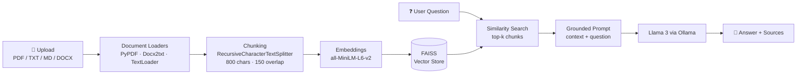

# 🤖 RAG Knowledge Assistant

A fully local **Retrieval-Augmented Generation (RAG)** app that lets you upload your own documents and ask questions about them. Answers are grounded strictly in the uploaded content, with the source chunks shown for every response.

No paid APIs, and no data leaves your machine: embeddings run on Hugging Face Sentence-Transformers and the LLM runs locally through **Ollama (Llama 3)**.


---

## 📸 Demo

| Querying a resume | Querying a research paper |
|---|---|
| 
| 
|

*Two documents of very different types (a 1-page resume and the "Attention Is All You Need" paper) indexed together. The assistant retrieves the right one for each question.*

---

## ✨ Features

- **Multi-format ingestion**: upload PDF, TXT, Markdown and DOCX files, several at once
- **Grounded answers**: the prompt restricts the LLM to the retrieved context and returns *"Not found"* when the answer isn't in the documents
- **Source citations**: every answer has an expandable panel showing which file and passage it came from
- **Tunable retrieval**: a sidebar slider adjusts how many chunks (k = 1–6) are passed to the LLM
- **Persistent index**: the FAISS index is saved to disk and reloaded on restart, so documents aren't re-embedded every run
- **Chat history**: the conversation is kept in session state, with citations preserved per message
- **100% local & free**: open-source embeddings plus a local LLM; no API keys needed

---

## 🏗️ Architecture



**Flow**

1. **Ingest**: uploaded files are written to temp files and parsed by the matching LangChain loader. Each document is tagged with its filename as `source` metadata.
2. **Chunk**: text is split into ~800-character chunks with a 150-character overlap so ideas aren't cut off at chunk boundaries.
3. **Embed & index**: chunks are embedded with `sentence-transformers/all-MiniLM-L6-v2` and stored in a FAISS index persisted to `./vectorstore`.
4. **Retrieve**: the user's question is embedded and the top-k most similar chunks are fetched.
5. **Generate**: the chunks, each labelled with its source, are placed into a strict prompt and sent to Llama 3. The answer and its source chunks are displayed in the UI.

---

## 🛠️ Tech Stack

| Layer | Tool |
|---|---|
| UI | Streamlit |
| Orchestration | LangChain |
| Document loading | PyPDFLoader, Docx2txtLoader, TextLoader |
| Chunking | RecursiveCharacterTextSplitter |
| Embeddings | Hugging Face `all-MiniLM-L6-v2` |
| Vector store | FAISS (persisted locally) |
| LLM | Llama 3 via Ollama |

---

## 🧠 Design Decisions

- **Local-first stack.** Ollama + Sentence-Transformers keeps the app free to run and keeps private documents (resumes, internal docs) on the user's own machine.
- **`all-MiniLM-L6-v2` for embeddings.** It's small (~80 MB) and fast on CPU while still giving good semantic search quality, which suits a laptop setup.
- **Chunk size 800 / overlap 150.** Large enough to hold a full paragraph or resume section, with enough overlap that answers spanning a boundary still get retrieved.
- **Source-tagged context.** Each retrieved chunk is prefixed with its filename in the prompt, so the model can tell which document it's reading when several are indexed.
- **Strict prompting.** The model is told to use *only* the provided context and to say "Not found" otherwise. This trades some flexibility for trustworthiness.
- **FAISS over a hosted vector DB.** No server to run, and the index saves to a single folder, which is ideal for a self-contained app.

---

## 🚀 Getting Started

### Prerequisites
- Python 3.10+
- [Ollama](https://ollama.com/) installed and running

### 1. Clone the repo
```bash
git clone https://github.com/<your-username>/rag-knowledge-assistant.git
cd rag-knowledge-assistant
```

### 2. Install dependencies
```bash
python -m venv venv
source venv/bin/activate        # Windows: venv\Scripts\activate
pip install -r requirements.txt
```

### 3. Pull the LLM
```bash
ollama pull llama3
```

### 4. Run the app
```bash
streamlit run app.py
```

Open `http://localhost:8501`, upload documents in the sidebar, click **Index Uploaded Files**, and start asking questions.

---

## 📁 Project Structure

```
rag-knowledge-assistant/
├── app.py              # Streamlit UI: upload, chat, citations, index status
├── rag_pipeline.py     # Loading, chunking, embedding, FAISS, retrieval, LLM call
├── requirements.txt
├── assets/             # Screenshots for this README
└── vectorstore/        # Persisted FAISS index (auto-created, git-ignored)
```

---

## 💡 Example Questions

| Document | Question | Result |
|---|---|---|
| Resume (PDF) | *"What are the skills mentioned in the resume?"* | Structured list of all technical & business skills |
| *Attention Is All You Need* (PDF) | *"Explain the attention"* | Definition of attention as a query/key-value mapping, pulled from the paper |

---

## 🔮 Limitations & Future Work

- [ ] **Incremental indexing**: add new uploads to the existing index instead of reusing the old one
- [ ] **Evaluation**: measure retrieval hit rate and answer faithfulness with a labelled Q&A set (e.g. RAGAS)
- [ ] **Hybrid search + re-ranking**: combine BM25 keyword search with dense retrieval and add a cross-encoder re-ranker
- [ ] **Conversational memory**: support follow-up questions that refer to earlier turns
- [ ] **Page-level citations**: show the PDF page number alongside the filename
- [ ] **Streaming responses**: stream tokens from the LLM for a faster-feeling UI
- [ ] **Model selector**: choose between Ollama models from the sidebar

---

## 👩‍💻 Author

**Himani Singh**
[LinkedIn](https://linkedin.com/in/<your-profile>) · [GitHub](https://github.com/<your-username>) · [Email](mailto:<your-email>)

If you found this useful, consider giving it a ⭐!
